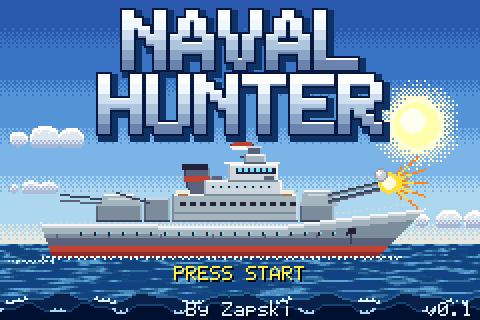
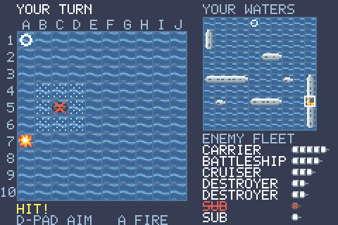
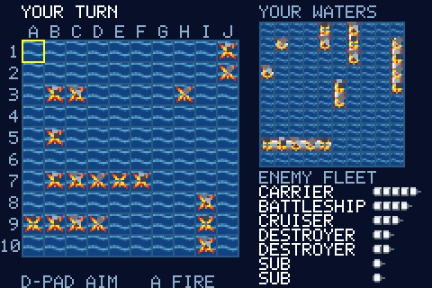
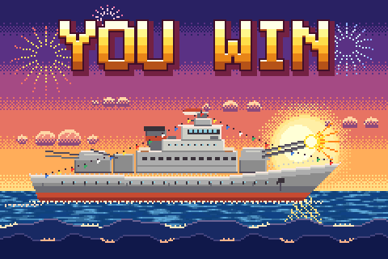
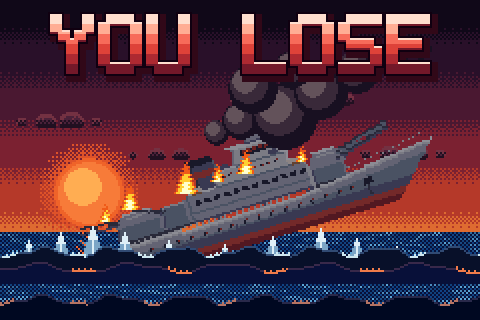

# Naval Hunter (GBA)

A full-colour Game Boy Advance port of [Naval Hunter](https://github.com/Zapskii/GB-NavalHunter), turn-based naval
combat for the original Game Boy. You against the computer: hunt and sink its fleet before it sinks yours. Both
boards are always on screen, every shell flies, and the top level plays against whole fleets it imagines.

 

  

## Controls

| Screen | Buttons |
|---|---|
| Title | START |
| Menu | A random fleet, B place your own, SELECT changes the level (EASY, NORMAL, HARD, ADMIRAL) |
| Placing ships | D-pad moves, B turns, A places, START randomises the rest |
| Battle | D-pad aims, A fires, A or B skips an animation |
| Win or lose picture | START or A skips it |
| Both fleets, at the end | START plays again |

## How it plays

Each side has seven ships: a carrier, a battleship, a cruiser, two destroyers and two subs. Ships may not touch, so
the cells around a sunk ship can't hold anything: they show as dotted water and can't be fired at. A ring is a miss
and a spiked cross a hit. Firing at a spent square costs no turn.

Your board, with the enemy's last shot marked, is on the right, over the list of enemy ships.

The computer plays fair at every level: it sees only what you could see, and a test pins that.

- **EASY** fires at random.
- **NORMAL** fires at random clear of known ships, tries the squares around a hit, and follows the line once it has one.
- **HARD** does the same, but hunts at the square the most still-possible ship placements would cover.
- **ADMIRAL** samples whole fleets that fit everything it has seen and fires where most of them have a ship. It also
  deals its own fleet with some care, instead of at random, before you do anything.

A skip changes nothing in the game, because the rules resolve before the shell leaves. ADMIRAL samples against the
clock, so its shots can differ from one run to the next if the timing does.

## What changed from the Game Boy version

The rules are the GB game's. Being on a GBA changed these:

| | Game Boy | GBA |
|---|---|---|
| Boards | One at a time, SELECT flips | Both always on screen |
| Top level | HARD | ADMIRAL above it |
| Water around a sunk ship | Plain | Marked, and can't be fired at |
| Art | 4 greys | Full colour: real hulls, and a picture for the title, a win and a loss |
| Battle | A flash on a hit | Shells on an arc, splashes, explosions, smoke, a shake on a sinking |
| Sea | Still | Moving |
| Music | A four-note jingle at the end | A title tune, a quiet battle loop, longer jingles |
| Effects | Noise channel | Synthesised samples on Direct Sound |

## Build

Needs Docker (the `devkitpro/devkitarm` image).

    make            # navalhunter.gba
    make run        # open it in mGBA
    make test       # host tests of the rules and the AI
    make e2e        # plays the real ROM headlessly in libmgba (brew install mgba); shots/

The art and the sounds are drawn and synthesised from nothing by `tools/gen_art.py` (needs Pillow) and
`tools/gen_sfx.py` (standard library only). Their output in `src/` is committed, so a plain `make` needs no Python.

Tested in mGBA only, not yet on a real GBA or flash cart.

## Licence

MIT, see [LICENSE](LICENSE).
