# Naval Hunter (GBA): Player Guide

Two fleets, two grids, one shell at a time. You can't see the enemy's ships, and it can't see yours. Sink all seven
of its ships before it sinks all seven of yours.

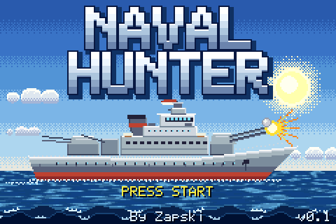

## Controls

| Screen | Button | Action |
|---|---|---|
| Title | START | Go to the menu |
| Menu | A | Deal your fleet at random and start |
| | B | Place your own fleet |
| | SELECT | Change the level |
| Placing ships | D-pad | Move the ship |
| | B | Turn it |
| | A | Place it |
| | START | Deal the rest at random and start |
| Battle | D-pad | Aim (hold to keep moving; the cursor wraps round the edges) |
| | A | Fire |
| | A or B, while a shot is showing | Skip the animation |
| Win or lose picture | START or A | Skip it |
| Both fleets, at the end | START | Play again, from the menu |

There's no pause, and none is needed: nothing happens until you fire. Nothing is saved when you switch off.

## Starting a game

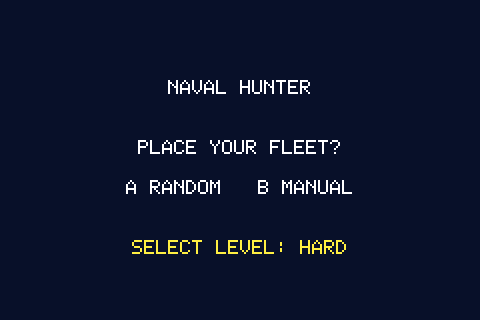

Press SELECT until you see the level you want, then press A or B. The level stays set when you play again.

### The fleet

Both sides have the same seven ships:

| | Length | How many |
|---|---|---|
|  | 5 | 1 |
|  | 4 | 1 |
|  | 3 | 1 |
|  | 2 | 2 |
|  | 1 | 2 |

That's 18 squares to hit on each side.

### Placing your own

Ships come in order, longest first. **Ships may not touch, not even at a corner.** The bottom line names the ship and
says **OK** or **NO FIT**. A ship that doesn't fit shows in red, and pressing A then says **TOO CLOSE** and leaves it
unplaced. After each ship is placed, the next one starts at the top left, often on top of something, so expect to
see it red at first.

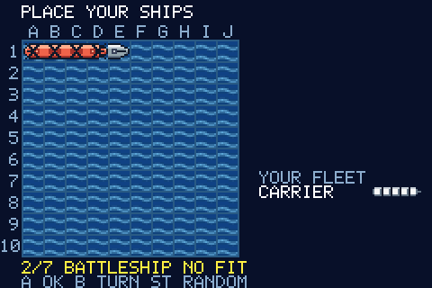
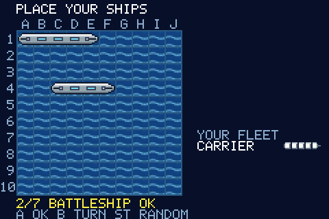

## The screen

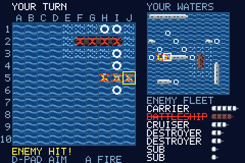

- **Left, the big board:** the enemy's waters, where you aim. The yellow square is your cursor.
- **Top right, YOUR WATERS:** your fleet and the enemy's shots. A white square marks its last shot.
- **Bottom right, ENEMY FLEET:** what you still have to sink. A sunk ship is crossed out in red.
- **Bottom left:** the result of the last shot.

### Reading the boards

| | Mark | Means |
|---|---|---|
|  | Plain water | Unknown on the enemy's board. Nothing there on yours. |
|  | Ring | A miss. |
|  | Spiked cross, smoking | A hit on the enemy's board. It doesn't show which way the ship runs. |
|  | Spiked cross on a hull | A hit on your own ship. |
|  | Red X on a charred hull | A sunk ship. Now you can see its shape. |
|  | Dotted water | Next to a sunk ship, so it can't hold a ship. |

## How a turn goes

You fire, then the enemy fires. A hit doesn't earn another shot.

Your shell arcs across the screen, and you only find out what it did when it lands: a splash for a miss, an explosion
for a hit. A sinking blasts along the whole ship, with a bright flash and a shake, and the ship goes red in the fleet
list. Then the enemy's turn runs the same way on your board.

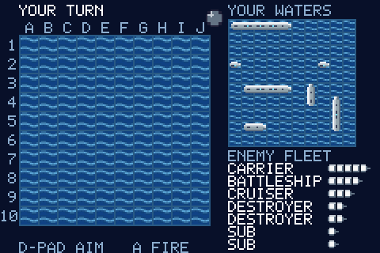
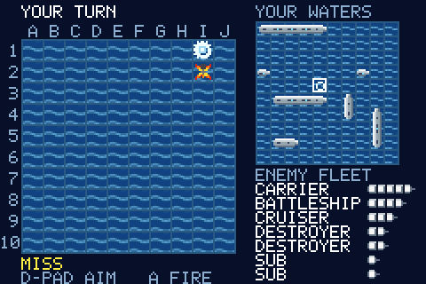

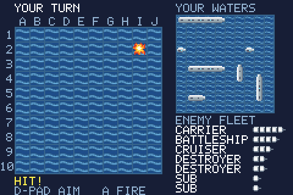
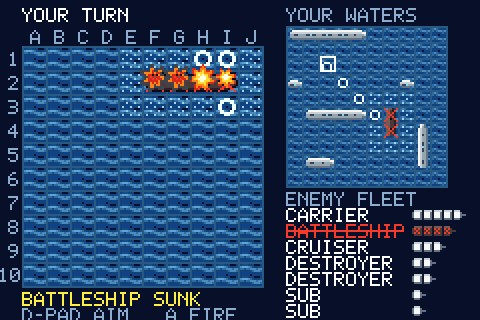

Each shot takes about a second. To hurry things along, press A or B while one is showing. That only skips the
animation and never changes the result, and it doesn't fire your next shot. Holding a button down doesn't skip.

Two shots are refused and don't cost you a turn:

- **ALREADY SHOT:** you've fired at that square before.
- **KNOWN WATER:** the dotted squares around a sunk ship.

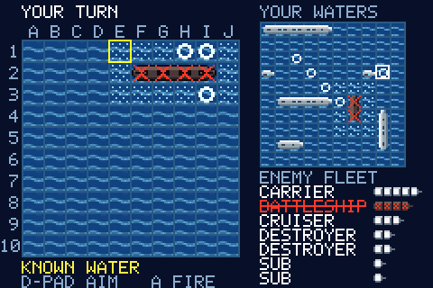

## The levels

The computer plays fair at every level. It knows only what you could know: where its shots landed, and which ships
it has sunk. It never looks at your hidden fleet.

EASY, NORMAL and HARD all try the squares around a hit and follow the line once they have two in a row. They differ
in how they search:

| Level | How it searches | Shots to sink a random fleet: average, worst |
|---|---|---|
| **EASY** | At random, even into water it could rule out | 83, 100 |
| **NORMAL** | At random, but clear of ships it has already found | 59, 87 |
| **HARD** | At the square the most possible ship positions would cover | 54, 81 |
| **ADMIRAL** | Imagines hundreds of whole fleets that fit what it has seen, and fires where most of them have a ship | 53, 78 |

Those numbers come from simulated games. They're a target to beat: on NORMAL, you need to finish in under about 59
shots to win more often than not.

**ADMIRAL** also places its own fleet with care instead of at random. It deals several fleets and keeps the one that
looks hardest to find, so expect to need a few more shots than on HARD. It's the only level that does this.

## Winning and losing

The first side to lose all seven ships loses the game. You get the win or lose picture for about 5 seconds (after a moment you can skip it), then both
fleets in full, your shots and how many of them hit. Press START to play again.

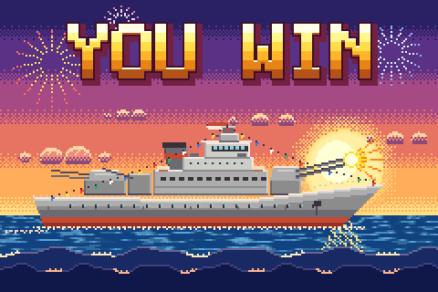
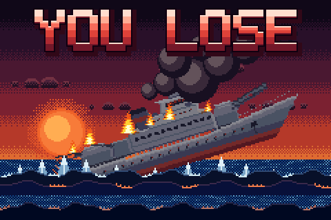

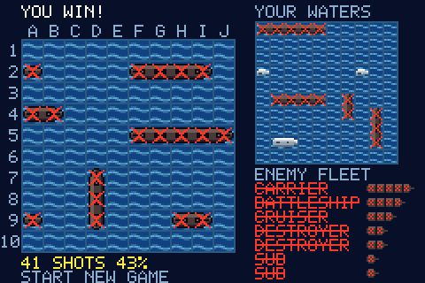
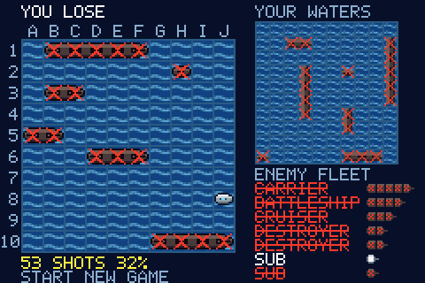

## Tips

- **The corners of a hit are always water.** Ships run in straight lines and can't touch, so only the four squares
  directly next to a hit can hold the rest of that ship. Don't waste shots on the diagonals.
- **Two hits in a row give you the line.** The squares along the sides of those hits are water too.
- **Spread your search.** Until you've found the longer ships, fire with gaps between your shots. Close the gaps
  as the long ships go down. Check the fleet list to see what's left.
- **Expect the subs to come last.** A one-square sub can sit in any gap, and one hit sinks it. Dotted water helps a lot
  here, since it rules squares out for free.
- **Use the wrap.** The cursor wraps round the edges, so from column A, one press left takes you to column J.
- **Check the edges on ADMIRAL.** Its careful fleets sit on the edge of the board a little more often than a random
  fleet does, though not by so much that you can count on it.

---

Naval Hunter for Game Boy Advance, v0.1. A port of the Game Boy original by Zapski.
